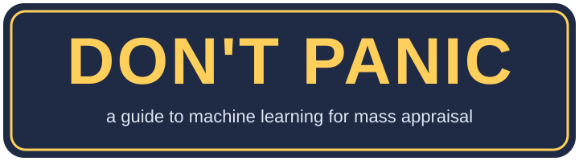
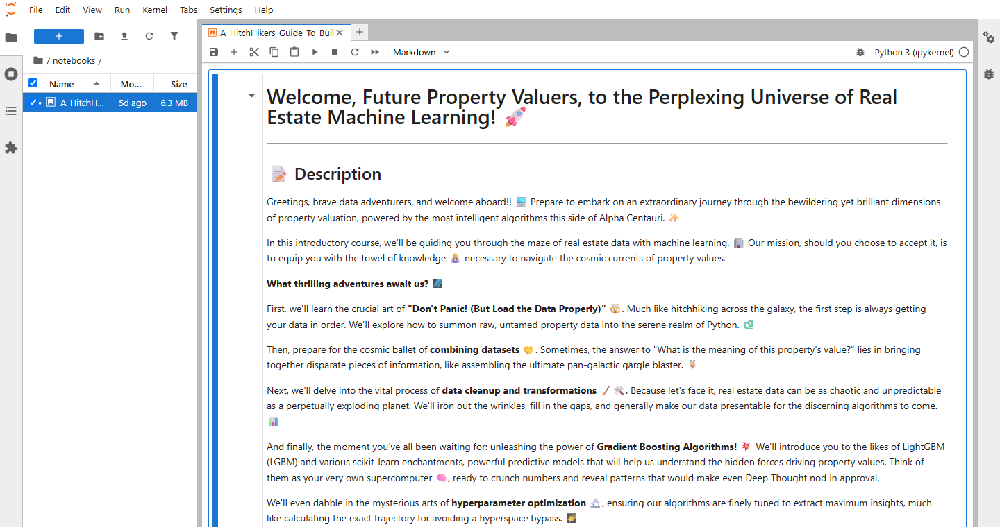
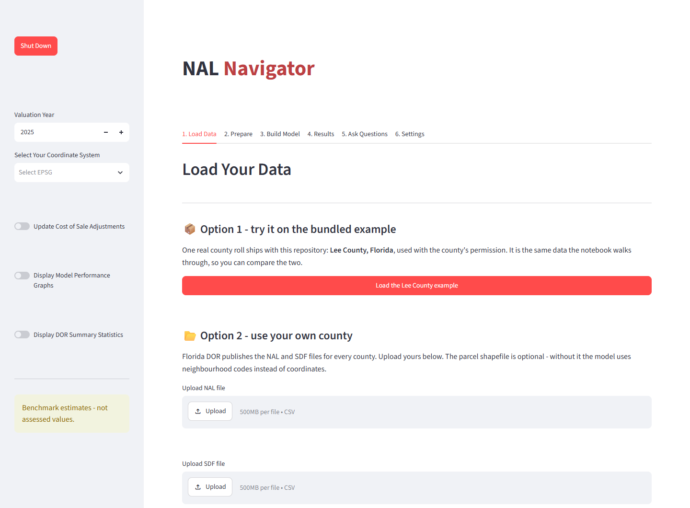
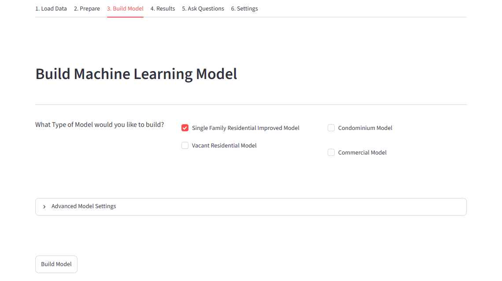
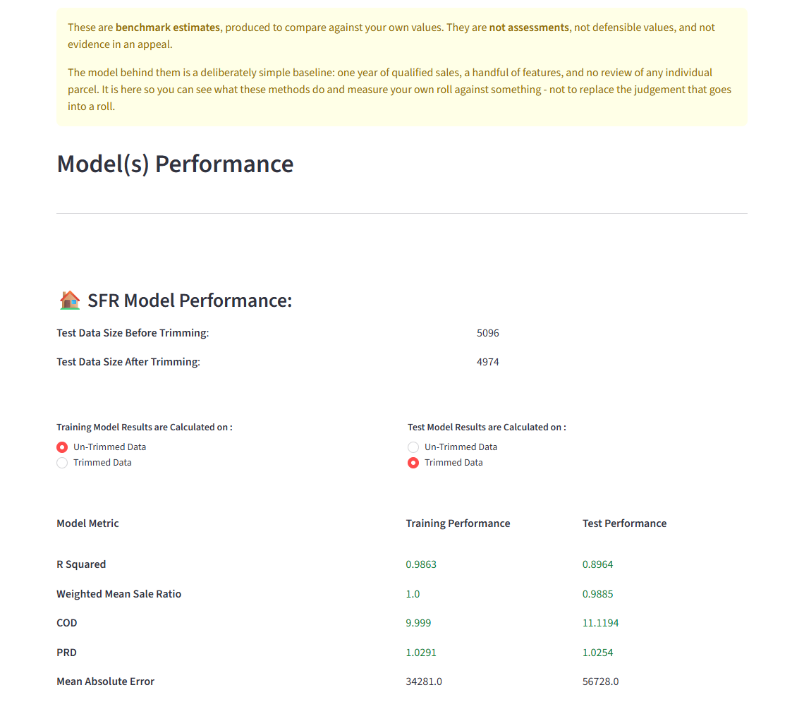
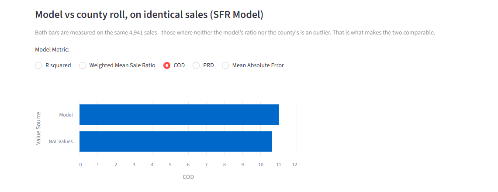
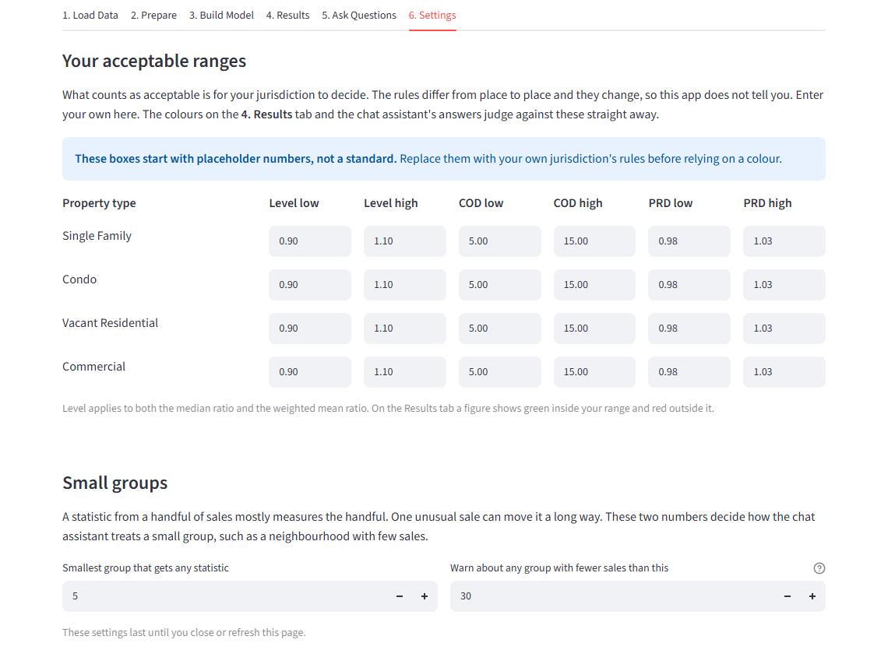
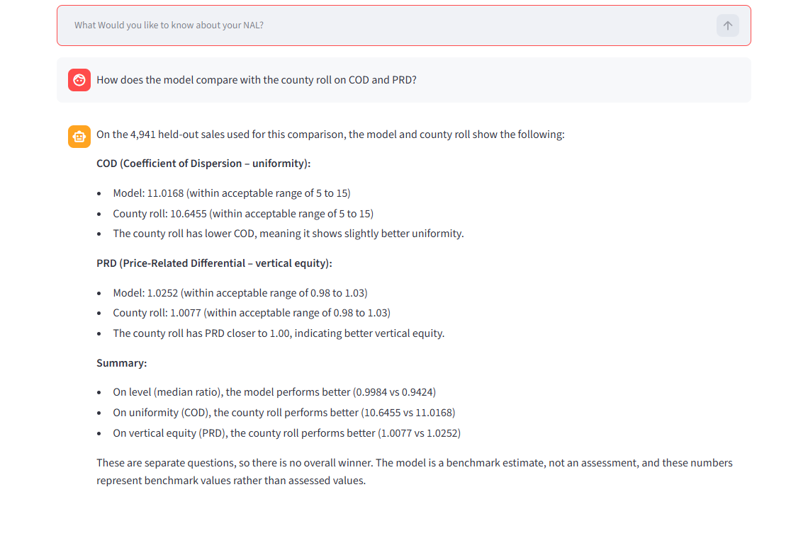
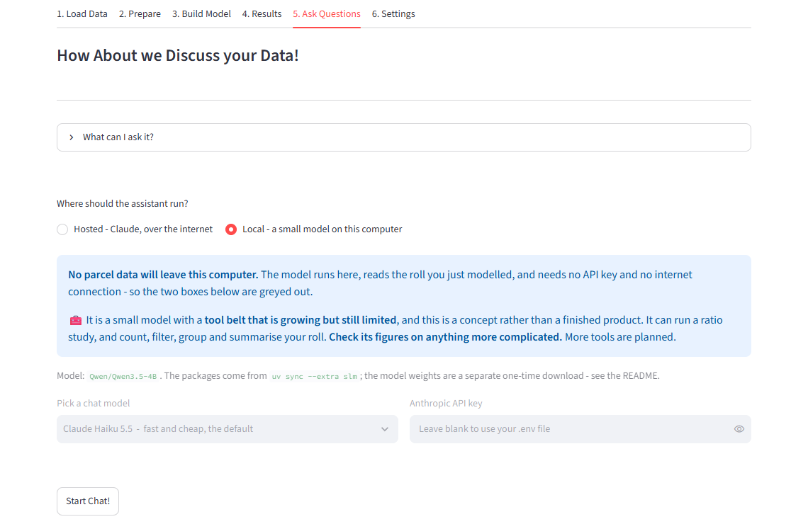

<p align="center">
  
</p>

<h1 align="center">🐬 A Hitchhiker's Guide to Mass Appraisal</h1>

<p align="center">
  <strong>Machine learning for property valuation, explained for appraisers, on a real Florida tax roll.</strong>
</p>

<p align="center">
  <a href="#-get-started"></a>
  
  
</p>

<p align="center">
  
  
  
  
  
  <a href="LICENSE"></a>
</p>

---

> *In the beginning the tax roll was created. This has made a lot of people very angry
> and been widely regarded as a bad move.*

Mass appraisal is slow to adopt new technology. Not because the people are slow, but
because of funding, fear of the unknown, and genuinely not knowing where to start.

**This is where to start.** It is a give-back to the community: a way for an individual
assessor to see what machine learning can do for valuation, and to try it on data they
recognise. You don't need to be an engineer, you don't need to already know Python, and
you don't need a graphics card. A towel is recommended but not enforced.

There are two things in the box:

| | What it is | Who it's for |
|---|---|---|
| 📖 **[The Guide](#-read-the-notebook)** | A notebook that builds a gradient boosting model step by step on a real county roll, and explains every step for an appraiser. No installing needed just to read it. | Anyone who wants to understand how this works |
| 💻 **[NAL Navigator](#-run-the-app)** | An app. Load a Florida county roll, click a few buttons, and get benchmark values to compare against your own, with no code. | Anyone who wants to try it on a roll |

> ### 🛑 Mostly harmless, on one condition
>
> **Everything this produces is a benchmark estimate.** It is not an assessment, not a
> defensible value, and not evidence in an appeal. Please don't paste it into a notice of
> value. An assessor who does that has been failed by this page, so this page is saying so.
>
> The goal is something to **benchmark your own values against**, and a safe place to
> dabble. It is **not** an attempt to build the best values ever produced.

### The Guide to this Guide

1. [🚀 Get started](#-get-started) (a few minutes)
2. [📖 Read the notebook](#-read-the-notebook)
3. [💻 Run the app](#-run-the-app)
4. [💬 Ask your roll questions](#-ask-your-roll-questions)
5. [🆘 When something goes wrong](#-when-something-goes-wrong)
6. [📚 What you'll actually learn](#-what-youll-actually-learn)
7. [🧰 What's in the box](#-whats-in-the-box)
8. [📦 The data](#-the-data)

---

## 🚀 Get started

Steps 3 and 4, the notebook and the app were all run from a fresh download on Windows 11
before this page was written. Step 2 is straight from uv's own instructions. It takes a few
minutes, and most of that is downloading.

### What you need

| | Do you need it? |
|---|---|
| **A computer** | Windows 11 is what this was built and tested on. Every tool here also supports Windows 10, macOS and Linux, but nobody has tried them yet, so please tell us how it goes. |
| **Python** | Nope. The next step brings its own. |
| **Admin rights** | Nope. Everything installs inside your own user folder and this project's folder. |
| **Graphics card** | Nope. Gradient boosting is a job for an ordinary processor. |
| **Disk space** | About **3.1 GB** once everything is unpacked. |
| **Memory** | On Lee County, the app and the notebook each peak at about **5 GB**. The app settles at about 2 GB once its merge is done. On an 8 GB laptop, close what you can first. |
| **Internet** | Only to install. After that, the valuation work runs with no connection. |

### Step 1: Open a terminal

That's the black window with the blinking cursor. If it makes you feel like Arthur Dent on
a Thursday, you're among friends. You're going to paste about five lines into it.

- **Windows:** press the Start button, type `terminal`, and press Enter.
- **macOS:** press `Cmd + Space`, type `terminal`, and press Enter.

### Step 2: Install `uv`

[`uv`](https://docs.astral.sh/uv/) is the only thing you install by hand. It fetches the
right Python and every package this project needs, and keeps them all inside this project,
so nothing else on your computer changes. No admin rights needed.

**Windows:**

```powershell
powershell -ExecutionPolicy ByPass -c "irm https://astral.sh/uv/install.ps1 | iex"
```

**macOS or Linux:**

```bash
curl -LsSf https://astral.sh/uv/install.sh | sh
```

**Now close the terminal and open a new one.** A terminal only notices a new program when it
starts. Check it worked, and you should see a version number:

```bash
uv --version
```

### Step 3: Get this repository

Pick whichever suits you. Both end up in the same place.

**If you have git:**

```bash
git clone https://github.com/Joshua-Data-Wizard/hitchhikers-guide-to-mass-appraisal.git
cd hitchhikers-guide-to-mass-appraisal
```

**If you don't have git** (common on a county laptop, and fine):

1. On this page, click the green **Code** button, then **Download ZIP**.
2. Right-click the file in your Downloads folder and choose **Extract All**.
3. In your terminal, go to the folder it made. It will be named something like this:

   ```powershell
   cd $HOME\Downloads\hitchhikers-guide-to-mass-appraisal-main\hitchhikers-guide-to-mass-appraisal-main
   ```

> 💡 **Keep it somewhere short**, like `C:\Users\you\GitHub\`. A folder six levels deep
> inside a long OneDrive name is asking for trouble.

### Step 4: Build the environment and unpack the data

From inside that folder:

```bash
uv sync
uv run python scripts/extract_data.py
```

`uv sync` installs everything, which takes a minute or two the first time.
`extract_data.py` takes about five seconds and tells you when it's done.

<details>
<summary>Why does the data need unpacking?</summary>

The tax roll is about **1.4 GB**, and GitHub refuses any file over 100 MB. So it ships
gzipped at about 165 MB, and that script puts it back exactly, checked against
SHA-256 checksums. **Nothing is downloaded.** It's already in the folder you just got.

</details>

**🎉 That's it. You are now better prepared than Arthur Dent ever was.**

From here on, run every command **from this folder**, and start each one with `uv run`.
There's nothing to activate and nothing else to remember.

---

## 📖 Read the notebook

**The Guide** is one file:
[`notebooks/A_HitchHikers_Guide_To_Building_A_Machine_Learning_Model.ipynb`](notebooks/A_HitchHikers_Guide_To_Building_A_Machine_Learning_Model.ipynb)

It has 254 cells of code and explanation, and every result is saved in the file. So there
are three ways in, depending on how far you want to go.

### Way 1: Just read it (nothing to install)

Click the link above. GitHub shows the whole thing, with the charts and results, in your
browser.

It's a big file, and GitHub sometimes gives up with *"Unable to render"*. If so, here's the
same notebook on
[nbviewer](https://nbviewer.org/github/Joshua-Data-Wizard/hitchhikers-guide-to-mass-appraisal/blob/main/notebooks/A_HitchHikers_Guide_To_Building_A_Machine_Learning_Model.ipynb),
which handles big ones better.

### Way 2: Run it yourself in JupyterLab (recommended)

Reading is good. Changing a number and watching what happens is how it sticks.

```bash
uv run jupyter lab
```

Your browser opens JupyterLab. Then:

1. In the file panel on the left, double-click the **`notebooks`** folder.
2. Double-click **`A_HitchHikers_Guide_To_Building_A_Machine_Learning_Model.ipynb`**.
3. Check the top right says **`Python 3 (ipykernel)`**. It should, with nothing to choose.



To run it, click on the first cell and press **`Shift + Enter`** to run a cell and move to
the next. Going a cell at a time is the point. You can also use **Run → Run All Cells**,
which took between 15 and 28 minutes on a fast desktop, so allow longer on a laptop. One big
search accounts for nearly all of that difference.

Three times along the way the Guide hands you the controls, and says **Take the Helm** or
**Your turn!** Two of them leave you blank cells to play in. The third has a working answer
already in place, because everything after it depends on that step, and the next cell checks it.
Nothing breaks if you skip them, but do try. That's where the learning is.

**To stop:** close the browser tab, click into the terminal, and press `Ctrl + C`.

### Way 3: Run it in VS Code

If you already use [VS Code](https://code.visualstudio.com/), this repo is set up for it.

1. Do [Step 4](#step-4-build-the-environment-and-unpack-the-data) first if you haven't.
2. Go to **File → Open Folder** and open this folder.
3. Accept the two extensions it offers: **Python** and **Jupyter**.
4. Open the notebook from the `notebooks` folder.
5. If it asks for a kernel, choose the one named **`.venv`**.

---

## 💻 Run the app

**NAL Navigator** takes a Florida county roll and gives you benchmark values, with no code at
all. It runs on your computer, in your browser, and your roll stays on your machine.

```bash
uv run streamlit run app/NAL_Navigator.py
```

Your browser opens at **http://localhost:8501**. If it doesn't, type that address in
yourself. **Leave the terminal open** while you use the app, because that's the engine room.

The tabs across the top are the steps, in order. Here's the whole trip on the bundled
example. The times are from a fast desktop, so allow longer on a laptop.

### 1. Load Data



Click **Load the Lee County example** and wait about 10 seconds for the *"Lee County loaded"*
tick. It's the same real roll the notebook uses, so the two can be compared.

<details>
<summary>🗂️ Using your own Florida county instead</summary>

Florida's Department of Revenue publishes these files for every county.

1. Under **Option 2**, upload your county's **NAL** file (the parcels) and **SDF** file (the
   sales). Both are CSV files, up to 500 MB each.
2. *Optional:* type the path to your parcel shapefile and click **Load GIS File**. Keep the
   `.shp`, `.dbf`, `.shx` and `.prj` together in one folder. Without a shapefile, the model
   uses neighbourhood codes instead of coordinates.
3. If you loaded a shapefile, choose your county's **coordinate system** in the left sidebar:
   `EPSG:2236` for Florida East, `EPSG:2237` for Florida West, or `EPSG:2238` for Florida
   North. ⚠️ If you leave it blank, the app assumes `EPSG:2237`, which is Lee County's. The
   wrong zone quietly puts every parcel in the wrong place, and nothing will warn you.

A roll from outside Florida would need its columns reshaped to match the NAL layout first.

</details>

### 2. Prepare

Click **Merge and Preprocess My Files**. It takes about 10 seconds to join the roll, the sales
and the parcel shapes, and it then shows you the first rows so you can see what it made.

**Optional:** to change Florida's DR-493 cost-of-sale adjustment by use code, switch on
**Update Cost of Sale Adjustments** in the sidebar.

### 3. Build Model



Tick the kinds of property you want. **Single Family Residential Improved** is the place to
start. Click **Build Model**, and it's done in about 10 seconds.

Under **Advanced Model Settings**, you can tick **Run Hyperparameter Tuning** to search for
better settings with Optuna. This is the fun part, and it's how you catch the machine learning
bug. It tells you how long it expects to take before you press anything. At the default 50 trials
it says roughly 4 minutes, and it took a little over 3 on a fast desktop. The test sales stay
sealed the whole time, so the number you get at the end stays honest.

### 4. Results



**Training** is how the model does on the sales it learned from. **Test** is how it does on
sales it has never seen. Test is the one to believe.

Two switches in the sidebar add more:

- **Display Model Performance Graphs** adds the comparison that matters: your county's roll
  against the model, **on identical sales**, because anything else flatters one side.
  In the chart, `NAL Values` is your roll.

  

- **Display DOR Summary Statistics** adds tables laid out like the report a jurisdiction files
  with the Department of Revenue. They use all of your qualified sales, the way the department
  does.

Further down, you can **download every benchmark estimate**. The column is named
`Benchmark_Estimate` so the warning travels with the file.

> 🧑‍🔬 **Coming from linear regression?** A gradient boosting model can fit the sales it learned
> from far more closely than it can predict new ones. That's why this app holds some sales back
> as a test, and why those two columns look so different. It's the single most useful idea here.

### 5. Ask Questions

Chat with your roll in plain English. [It has its own section below](#-ask-your-roll-questions).

### 6. Settings



**What counts as acceptable is for your jurisdiction to decide**, so this app doesn't tell you.
Enter your own ranges here. The green and red on the Results tab, and the assistant's answers,
judge against them straight away. The boxes start with placeholder numbers rather than a
standard, so replace them before relying on a colour. They reset when you refresh the page.

### When you're done

Click the red **Shut Down** button at the top of the sidebar, then close the tab. So long, and
thanks for all the parcels.

---

## 💬 Ask your roll questions

The **Ask Questions** tab lets you ask things like *"how does the model compare with the county
roll on COD and PRD?"*, and the answer comes back with the same figures as the Results tab.



There are two ways to run it, and you choose at the top of the tab:



| | ☁️ Hosted | 🏠 Local |
|---|---|---|
| **Runs on** | Anthropic's Claude, over the internet | A small model on your own computer |
| **Your data** | Your questions, and the rows the tools return, go to Anthropic | **No parcel data leaves your computer** |
| **You need** | An Anthropic API key, which costs a little per question | A one-time download of about 12 GB, and ideally a graphics card |
| **Good for** | Trying it right now | Offices whose IT won't approve the other one |

**To use Hosted:** get a key at [console.anthropic.com](https://console.anthropic.com), then
either paste it into the box on the tab, or put it in a `.env` file so you don't have to:

```powershell
Copy-Item .env.example .env     # on macOS or Linux: cp .env.example .env
```

Open `.env` and fill in `ANTHROPIC_API_KEY`. It's ignored by git, so it won't be shared by accident.

**To use Local:** there are two one-time steps.

```bash
uv sync --extra slm
uv run python -c "from huggingface_hub import snapshot_download; snapshot_download('Qwen/Qwen3.5-4B')"
```

⚠️ A plain `uv sync` later removes that extra again. If Local stops working, re-run the first
line. It's quick the second time.

### 🧰 Its tool belt is short

**This is a concept, not a finished product. Please check its figures on anything complicated.**
It has been checked on a list of questions, which is under **What can I ask it?** on the tab, and
the ratio study matches the Results tab to four decimals. Outside those tools it's relying on SQL
a language model wrote for itself, and that's where things can go wrong. It also doesn't compute
PRB yet.

The memory and speed of the local model, what it can't do and why, and how to check it yourself,
are all in **[docs/chat_assistant.md](docs/chat_assistant.md)**.

---

## 🆘 When something goes wrong

**Don't panic.** Most of these have a one-line fix.

| What you see | What to do |
|---|---|
| `uv` is not recognized | Close the terminal and open a new one. It only finds new programs when it starts. |
| `git` is not recognized | Use **Download ZIP** in [Step 3](#step-3-get-this-repository) instead. |
| A certificate or SSL error during `uv sync` | Common behind a county network. Try `uv sync --system-certs`. |
| `uv sync` can't connect at all | Your office may use a proxy. Ask IT for its address, then set it for this terminal with `$env:HTTPS_PROXY = "http://your-proxy:port"`, and try again. |
| A long path or "file not found" error on Windows | Move the folder somewhere shorter, like `C:\Users\you\GitHub\`. If you use git, run `git config --global core.longpaths true` once too. |
| The app says the data hasn't been unpacked | Run `uv run python scripts/extract_data.py`. |
| The browser didn't open | Go to **http://localhost:8501** yourself. |
| The address says `localhost:8502`, not `8501` | Another copy of the app is still running in another terminal. It's harmless, so carry on, and close the other one when you can. |
| A command can't find a file | You're probably in the wrong folder. Go back to this project's folder first, with `cd`. |
| Local says it needs optional packages | Run `uv sync --extra slm`, then start the app again. |
| Everything slows to a crawl during the merge, or a `MemoryError` | Lee County needs about 5 GB at that moment. Close other programs and try again. |
| `triton not found` on Windows, with Local | Harmless. Nothing here uses it. |
| `WinError 10054` in the terminal | Harmless. Windows noting that a connection closed. The app carries on. |
| A warning from GDAL in the terminal while the roll loads | Normal. A few parcel shapes in the county's file are unusual. |

Something else? [**Open an issue.**](https://github.com/Joshua-Data-Wizard/hitchhikers-guide-to-mass-appraisal/issues) It's a
genuine help, because corrections are the most valuable thing anyone can contribute to a teaching
repository.

---

## 📚 What you'll actually learn

The notebook goes the whole way, including the parts that usually get skipped:

- Loading and joining the **NAL** and **SDF** files every Florida county has
- Feature engineering an appraiser would recognise: effective age, time adjustment, quality codes,
  neighbourhood and market area
- Turning parcel polygons into coordinates the model can use
- **LightGBM, XGBoost and CatBoost** compared head to head, not asserted
- Watching a model **overfit on purpose**, then fixing it with early stopping
- Hyperparameter tuning from manual, to grid search, to **Optuna**, including **HPO leakage**, where
  tuning against your test set quietly flatters the result
- **Cross-validation**, and what an odd fold is actually telling you
- **IAAO ratio statistics** (COD, PRD, PRB), not just R². A board of equalization has never asked
  anyone for an R²
- **SHAP**, to turn "the computer said $412,000" into a line-item receipt, and to pull a depreciation
  curve straight out of the model
- An honest closing section on **what this model can't tell you**: one year of unvetted sales, a thin
  feature set, and why some of the SHAP curves look odd because of it

---

## 🧰 What's in the box

```
notebooks/   The Guide: 254 cells, saved with their outputs
app/         NAL Navigator, the Streamlit app
data/        The Lee County roll, compressed. See data/README.md
docs/        More detail on the chat assistant, and the pictures on this page
scripts/     extract_data.py (you ran this)
             check_chat_assistant.py (checks the chat assistant's answers)
             preflight.py, compress_data.py, take_readme_screenshots.py (for maintainers)
src/         deep_thought, the ratio statistics, in one place. It took a while
```

---

## 📦 The data

It's real, certified and public: the **2025 Lee County, Florida** tax roll, with 557,813 parcels,
123,666 sales and 559,141 parcel shapes. **Owners' names and mailing addresses have been taken out.**
Nothing here uses them, and [data/README.md](data/README.md#-what-we-removed-and-why) says exactly
what was removed.

**🙏 Lee County, Florida gave permission for this data to be used here.** The records are public, but
permission was asked anyway, because asking is the right way to do this.

⚠️ **These records describe real people's homes.** Please read
**[data/README.md](data/README.md)**, which covers where the data came from and what every column means
in appraisal terms.

---

## 🚧 Status

The notebook runs top to bottom, the app runs start to finish, and the install and run steps on this
page were tested from a fresh download on Windows 11. It's held to a high bar and it will still have
rough edges, so
[please tell us about them](https://github.com/Joshua-Data-Wizard/hitchhikers-guide-to-mass-appraisal/issues).

**What's coming:** PRB in the app once the IAAO's new standards land, and more tools for the assistant.

## 📄 License

MIT, see [LICENSE](LICENSE). Use it, teach from it, adapt it for your county.

That covers the code and the writing. The Lee County roll isn't ours to license: it's a public
record, shared here with the county's permission.

---

*See also: [88mph-mass-appraisal](https://github.com/Joshua-Data-Wizard/88mph-mass-appraisal), the same idea
for LLMs, agents and RAG. 🚗💨*

<p align="center"><em>So long, and thanks for all the fish.</em> 🐬</p>
